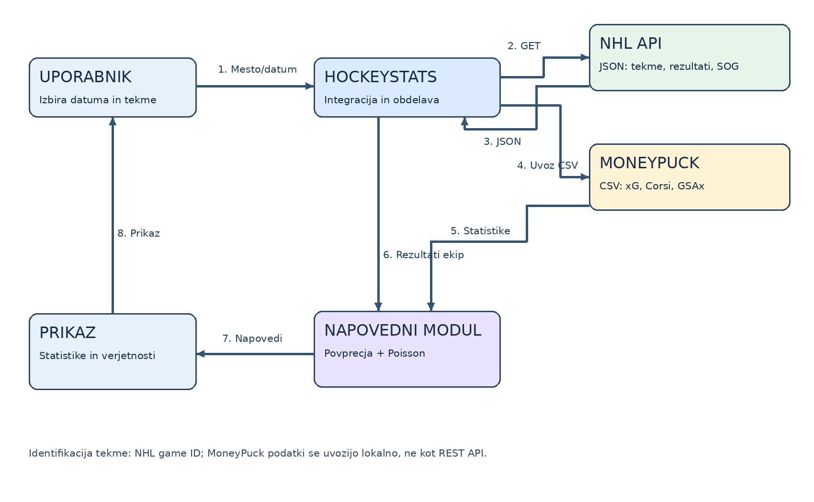

# HockeyStats – NHL Results, Advanced Analytics & Predictions

## Povzetek
Spletna aplikacija za pregled NHL tekem, povezovanje NHL API in MoneyPuck CSV podatkov ter izdelavo preprostih verjetnostnih napovedi na podlagi preteklih tekem.

**Status:** načrt / projekt za predmet TIDS. Implementacija še ni zaključena.

## Integrirani storitvi
1. **NHL API** – HTTP GET, JSON, urnik in rezultati: `https://api-web.nhle.com/v1/score/2026-10-12`; podrobnosti: `https://api-web.nhle.com/v1/gamecenter/{gameId}/landing`. [Dokumentacija skupnosti](https://github.com/pseudo-r/Public-NHL-API/blob/main/docs/web-api/games.md).
2. **MoneyPuck** – javni CSV prenosi naprednih statistik (ne REST API), [podatki in slovar](https://moneypuck.com/data.htm). Samo v skladu s pogoji vira; za nekomercialno uporabo ob navedbi MoneyPuck.com. Ni spletnega scrapinga.

## Načrtovane funkcionalnosti MVP
- Pregled NHL urnika in rezultatov ter izbira tekme.
- Prikaz osnovnih statistik in razpoložljivih naprednih kazalnikov (xG, Corsi, Fenwick, GSAx).
- Napovedi: pričakovani goli obeh ekip, skupno pričakovano število golov, izid po 60 min, verjetnost OT, verjetnost SO (približek), zmagovalec vključno z OT/SO (približek), over/under 5,5 in 6,5, najverjetnejši rezultat po 60 min, oba dosežeta gol, ekipa doseže vsaj 3 gole, shutout, pričakovani SOG in več SOG.
- Brez prijave in brez obvezne podatkovne baze.

## Osnovni izračuni
- `lambda_home = (povprecni_goli_domace + povprecni_prejeti_goli_gostujoce) / 2`
- `lambda_away = (povprecni_goli_gostujoce + povprecni_prejeti_goli_domace) / 2`
- Število golov po 60 minutah približamo s Poissonovo porazdelitvijo; ob neodvisnosti ekip dobimo matriko verjetnosti rezultatov.
- `P(OT) = P(goli_domaci == goli_gostje po 60 min)`.
- `P(SO)` približamo kot `P(OT) * zgodovinski_delez_SO_med_OT`.
- Končni zmagovalec zahteva dodatno predpostavko za razrešitev OT/SO; rezultat se jasno označi kot približek.
- Pri napovedih po 60 min ne uporabimo podatkov iz podaljška ali kazenskih strelov. Pri skupnih golih jasno navedemo, ali štejemo OT; gola iz SO ne prištevamo kot običajen dosežen gol ekipe.
- Podatki za napoved morajo biti znani pred napovedovano tekmo.

## Tehnična zasnova
React + Vite + JavaScript Fetch API, CSV parser (npr. Papa Parse), lokalni račun napovedi. Po potrebi statično predobdelan CSV za zanesljiv prikaz in preprečevanje CORS težav.

## Diagram

## Viri / pogoji
- NHL API: https://api-web.nhle.com/
- Opisi NHL API: https://github.com/pseudo-r/Public-NHL-API
- MoneyPuck podatki: https://moneypuck.com/data.htm (zahtevana navedba vira)

**Opomba:** napovedi so informativne in niso zagotovilo dejanskega izida.
