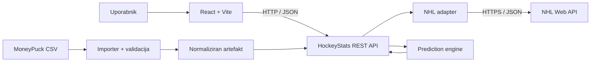

# HockeyStats

**NHL Results, Advanced Analytics & Statistical Predictions**

HockeyStats je načrtovana spletna aplikacija za spremljanje tekem lige NHL, pregled osnovnih in naprednih hokejskih statistik ter izdelavo **razložljivih statističnih napovedi** prihajajočih tekem. Podatke povezuje iz dveh različnih virov: **NHL Web API (JSON)** in **MoneyPuck (CSV)**.

Projekt nastaja v okviru študijskega predmeta **TIDS – integracija storitev**. Njegov glavni cilj je pokazati integracijo heterogenih zunanjih podatkov, njihovo preverjanje, normalizacijo, združevanje in predstavitev prek lastnega REST API-ja.

> **Status projekta (12. 10. 2026):** pripravljena sta projektna specifikacija in razvojni načrt. Spodaj opisane funkcionalnosti predstavljajo **načrtovani MVP**, ne že implementirane aplikacije. Dejanski napredek je označen v [razvojnih mejnikih](docs/11-MILESTONES.md).

## Vsebina

- [Glavne funkcionalnosti](#glavne-funkcionalnosti)
- [Podatkovni viri](#podatkovni-viri)
- [Tehnološki stack](#tehnološki-stack)
- [Arhitektura](#arhitektura)
- [Struktura repozitorija](#struktura-repozitorija)
- [Lokalni zagon](#lokalni-zagon)
- [REST API](#rest-api)
- [Napovedni model](#napovedni-model)
- [Načrt razvoja](#načrt-razvoja)
- [Dokumentacija in delo s Codexom](#dokumentacija-in-delo-s-codexom)
- [Testiranje in deployment](#testiranje-in-deployment)
- [Viri in omejitve](#viri-in-omejitve)
- [XML & JSON Data Integration Assignment](#xml--json-data-integration-assignment)

## Glavne funkcionalnosti

Načrtovani MVP vključuje:

| Modul | Kaj omogoča |
| --- | --- |
| **Dashboard** | Pregled tekem izbranega dne, rezultatov in statusov. |
| **Games** | Iskanje tekem po datumu in ogled podrobnosti posamezne tekme. |
| **Teams** | Pregled ekip, njihovih rezultatov, forme in razpoložljive sezonske statistike. |
| **Advanced Analytics** | Prikaz MoneyPuck xG, Corsi in Fenwick za odigrane tekme, kadar podatki obstajajo. |
| **Predictions** | Ocena verjetnosti izidov po 60 minutah, pričakovanih golov, pragov zadetkov in najverjetnejšega rezultata. |
| **Shots Predictions** | Ocena strelov in verjetnosti, katera ekipa bo imela več strelov, če je zgodovinskih podatkov dovolj. |
| **Data Transparency** | Prikaz vira, osveženosti in razpoložljivosti podatkov; razlaga predpostavk modela. |

Podrobne zahteve, vključitve in izključitve so v [obsegu projekta](docs/01-SCOPE.md).

## Podatkovni viri

### 1. NHL Web API

NHL Web API zagotavlja podatke v obliki **JSON**, predvsem:

- razporede in statuse tekem;
- rezultate ter podatke o ekipah;
- podrobnosti zaključenih tekem, vključno s streli, če so na voljo;
- zgodovino tekem, potrebno za statistično napovedovanje.

Osnovni naslov: <https://api-web.nhle.com/v1/>

NHL spletni endpointi niso obravnavani kot nespremenljiva javna pogodba; implementacija bo njihove odzive preverjala in pretvarjala v interne tipe. Podrobnosti: [`docs/03-NHL-INTEGRATION.md`](docs/03-NHL-INTEGRATION.md).

### 2. MoneyPuck

MoneyPuck je vir **CSV** podatkov za napredne hokejske metrike, kot so:

- **xG (expected goals)** – ocena kakovosti ustvarjenih in dovoljenih priložnosti;
- **Corsi** – delež vseh poskusov strelov;
- **Fenwick** – delež neblokiranih poskusov strelov;
- potencialno **GSAx** za vratarje v poznejši razvojni fazi.

Podatkov **ne bomo pridobivali s scrapingom**. Predviden je nadzorovan uvoz objavljenih CSV datotek, validacija dejanskih stolpcev in ustvarjanje manjšega normaliziranega artefakta. MoneyPuck podatki za pretekle tekme **niso vhod v MVP napovedni model**.

Uradna stran: <https://moneypuck.com/data.htm> · Podrobnosti: [`docs/04-MONEYPUCK-INTEGRATION.md`](docs/04-MONEYPUCK-INTEGRATION.md).

> Pri uporabi naprednih statistik bomo jasno navedli **MoneyPuck.com** in upoštevali veljavne pogoje njihove nekomercialne uporabe ter redistribucije.

## Tehnološki stack

| Sloj | Tehnologije |
| --- | --- |
| **Frontend** | React, Vite, TypeScript |
| **UI** | Tailwind CSS, React Router |
| **Zahteve in cache** | TanStack Query |
| **Grafi** | Recharts |
| **Backend** | Node.js, Express, TypeScript |
| **Validacija** | Zod |
| **Obdelava CSV** | `csv-parse` |
| **Testiranje** | Vitest, Supertest, React Testing Library |
| **Upravljanje paketov** | npm workspaces |
| **Načrtovani hosting** | Vercel (frontend), Railway (backend) |

**Baza podatkov in prijava uporabnikov nista del MVP-ja.** Izbire in utemeljitve so zapisane v [arhitekturi](docs/02-ARCHITECTURE.md).

## Arhitektura



**Načelo integracije:** frontend komunicira samo z lastnim backendom. NHL adapter skrbi za zunanje HTTP/JSON podatke, MoneyPuck importer za CSV, backend pa podatke validira in združi na ravni tekme, ekipe in situacije. Če MoneyPuck podatki manjkajo, mora prikaz NHL rezultatov še vedno delovati.

Za natančnejši opis glej [arhitekturo](docs/02-ARCHITECTURE.md), [podatkovne pogodbe](docs/05-DATA-CONTRACTS.md) in [API pogodbo](docs/06-API-CONTRACT.md).

## Struktura repozitorija

Načrtovana struktura po postavitvi projekta (M1):

```text
HockeyStats/
├── README.md                    # predstavitev projekta
├── AGENTS.md                    # trajna navodila za Codex
├── README-CODEX-SETUP.md        # začetek dela s Codexom
├── docs/                        # specifikacije in razvojni načrt
├── .agents/skills/              # projektni Codex skills
├── frontend/                    # React + Vite aplikacija
├── backend/                     # Express API, adapterji in model
├── shared/                      # skupni TS tipi in validacijske sheme
├── scripts/                     # priprava in uvoz MoneyPuck CSV
├── .env.example                 # predloga konfiguracije
├── package.json                 # npm workspaces
└── package-lock.json
```

> Mape za aplikacijsko kodo in `package.json` bodo nastale v **M1**. Njihova prisotnost v shemi ne pomeni, da so že ustvarjene.

## Lokalni zagon

### Predpogoji

- Git;
- aktualna podprta **Node.js LTS** različica, združljiva z izbrano verzijo Vite;
- npm;
- za MoneyPuck uvoz: ustrezna uradno pridobljena CSV datoteka.

### Postopek po zaključku M1

```bash
# 1. Kloniranje repozitorija (zamenjaj z dejanskim URL)
git clone <URL-REPOZITORIJA>
cd HockeyStats

# 2. Namestitev odvisnosti
npm install

# 3. Konfiguracija
cp .env.example .env

# 4. Zagon frontend in backend okolja
npm run dev
```

Na Windows PowerShell je ustrezen ukaz za kopiranje konfiguracije `Copy-Item .env.example .env`.

Predvideni razvojni naslovi:

| Storitev | Lokalni naslov |
| --- | --- |
| Frontend (Vite) | `http://localhost:5173` |
| Backend | `http://localhost:3001` |
| Health check | `http://localhost:3001/health` |

**Pomembno:** navedeni ukazi in naslovi so **ciljna konfiguracija po M1**. Če je v repozitoriju trenutno samo dokumentacija, `npm install` oziroma `npm run dev` še ne bosta delovala. Aktualna konfiguracijska pravila so v [`docs/12-DEPLOYMENT.md`](docs/12-DEPLOYMENT.md).

### Predvidene okoljske spremenljivke

```env
PORT=3001
NODE_ENV=development
NHL_BASE_URL=https://api-web.nhle.com/v1
CORS_ORIGIN=http://localhost:5173
MONEYPUCK_ARTIFACT_PATH=./backend/data/generated/moneypuck-games.json
NHL_FETCH_TIMEOUT_MS=8000
VITE_API_BASE_URL=http://localhost:3001/api/v1
```

Dejansko datoteko `.env` izključi iz Git repozitorija. Končni nabor spremenljivk in postopek uvoza CSV sta opisana v [deployment dokumentaciji](docs/12-DEPLOYMENT.md).

## REST API

Načrtovani interni API uporablja osnovno pot **`/api/v1`** in vrača JSON.

| Metoda | Endpoint | Namen |
| --- | --- | --- |
| GET | `/health` | Preverjanje delovanja backenda |
| GET | `/api/v1/games?date=YYYY-MM-DD` | Seznam tekem na datum |
| GET | `/api/v1/games/:gameId` | Podrobnosti tekme |
| GET | `/api/v1/games/:gameId/advanced?situation=all` | MoneyPuck metrike |
| GET | `/api/v1/teams` | Seznam ekip |
| GET | `/api/v1/teams/:abbr/games?season=20262027` | Tekme ekipe |
| GET | `/api/v1/teams/:abbr/summary?season=20262027` | Statistika in forma ekipe |
| GET | `/api/v1/predictions/:gameId` | Statistična napoved prihodnje tekme |

Zahteve, odgovori, statusne kode in obravnava napak so definirani v [`docs/06-API-CONTRACT.md`](docs/06-API-CONTRACT.md). **To je specifikacija; endpointi niso nujno že implementirani.**

## Napovedni model

HockeyStats uporablja **statistično osnovo**, ne kompleksnega strojnega učenja. Model je zasnovan na zgodovinskih NHL podatkih, povprečjih golov, zadnji formi, razdelitvi doma/gostje ter **Poissonovi porazdelitvi**.

Med načrtovanimi izhodi so:

- pričakovano število **regulacijskih golov** vsake ekipe;
- verjetnost domače zmage, izenačenja in gostujoče zmage **po 60 minutah**;
- najbolj verjeten regulacijski rezultat;
- over/under skupnega števila golov in pragovi zadetkov posameznih ekip;
- verjetnost, da obe ekipi dosežeta vsaj en oziroma dva gola;
- ocena strelov, če je dovolj podatkov;
- verjetnosti regulacijskega shutouta.

**MoneyPuck xG ni isto kot `expectedRegulationGoals`, ki ga izračuna HockeyStats.** Model ne bo uporabljal rezultatov ali statistik tekme, ki jo poskuša napovedati (*preprečevanje data leakage*). Izenačenje po rednem delu ne pomeni končnega neodločenega izida NHL. Metodologija in matematični testi: [`docs/07-PREDICTION-MODEL.md`](docs/07-PREDICTION-MODEL.md).

> Napovedi so informativne verjetnostne ocene, **ne zagotovilo rezultata** in ne priporočila za stave.

## Načrt razvoja

Razvoj je razdeljen na naslednje mejnike. Status preverjaj v [izvorni checklisti](docs/11-MILESTONES.md).

| Mejniki | Predvidena naloga |
| --- | --- |
| **M0** | Pregled repozitorija in uskladitev specifikacij |
| **M1** | npm workspaces, frontend, backend in skupni tipi |
| **M2** | Integracija NHL JSON |
| **M3** | MoneyPuck CSV importer |
| **M4** | Povezovanje obeh virov in advanced game view |
| **M5** | Dashboard, seznam tekem in strani ekip |
| **M6** | Prediction engine in REST endpoint |
| **M7** | UI napovedi, kakovost in deployment |
| **M8** | TIDS dokumentacija, demonstracija in oddaja |

Ne označuj mejnika kot opravljenega, dokler koda in preverjanja niso dejansko zaključeni.

## Dokumentacija in delo s Codexom

Celotna tehnična dokumentacija se nahaja v [`/docs`](docs/README.md). Najpomembnejše datoteke:

| Datoteka | Namen |
| --- | --- |
| [`AGENTS.md`](AGENTS.md) | Obvezna pravila in arhitekturne omejitve za Codex |
| [`README-CODEX-SETUP.md`](README-CODEX-SETUP.md) | Kako začeti in kateri prompt uporabiti |
| [`docs/01-SCOPE.md`](docs/01-SCOPE.md) | Funkcionalni in nefunkcionalni obseg |
| [`docs/02-ARCHITECTURE.md`](docs/02-ARCHITECTURE.md) | Stack, data flow in struktura kode |
| [`docs/05-DATA-CONTRACTS.md`](docs/05-DATA-CONTRACTS.md) | Enotni tipi in podatkovna pravila |
| [`docs/06-API-CONTRACT.md`](docs/06-API-CONTRACT.md) | REST API pogodba |
| [`docs/07-PREDICTION-MODEL.md`](docs/07-PREDICTION-MODEL.md) | Formule in modelna pravila |
| [`docs/11-MILESTONES.md`](docs/11-MILESTONES.md) | Razvojni načrt M0–M8 |
| [`docs/13-CODEX-WORKFLOW.md`](docs/13-CODEX-WORKFLOW.md) | Potek dela in primeri promptov |

Za posamezna področja so pripravljeni projektni Codex skills:

- [NHL API Integration](.agents/skills/nhl-api-integration/SKILL.md)
- [MoneyPuck Data Import](.agents/skills/moneypuck-data-import/SKILL.md)
- [Hockey Prediction Engine](.agents/skills/hockey-prediction-engine/SKILL.md)
- [HockeyStats Quality Check](.agents/skills/hockeystats-quality-check/SKILL.md)

**Priporočeni prvi poziv Codexu:**

```text
Preberi AGENTS.md, docs/README.md in docs/11-MILESTONES.md.
Najprej preveri obstoječe stanje repozitorija.
Izvedi samo M0 in M1. Postavi npm workspaces, React/Vite/TypeScript
frontend, Express/TypeScript backend, skupne tipe, .env.example in
testne ukaze. Ne implementiraj naslednjih mejnikov. Po zaključku
navedi spremenjene datoteke, rezultate testov in preostale omejitve.
```

## Testiranje in deployment

Po zaključku M1 so predvideni naslednji ukazi v korenu repozitorija:

```bash
npm run typecheck
npm run lint
npm test
npm run build
```

Testirati je treba zlasti adapterje zunanjih virov, CSV importer, povezovanje tekem, napake ob manjkajočih podatkih ter matematično pravilnost in reproducibilnost napovedi. Testi naj uporabljajo preverjene ali sintetične fixtures brez neupravičenega objavljanja izvornih MoneyPuck podatkov.

Predvideni deployment: **Vercel** za React aplikacijo in **Railway** za Express API. Povezavi do javne demonstracije in status CI se dodata šele po dejanski vzpostavitvi. Glej [testno strategijo](docs/10-TESTING.md) in [deployment](docs/12-DEPLOYMENT.md).

## XML & JSON Data Integration Assignment

Ta samostojni del projekta prikazuje branje, pretvorbo, povezovanje, filtriranje in izvoz strukturiranih XML ter JSON podatkov na primeru sintetičnih NHL tekem. Ne uporablja zunanjega API-ja ali MoneyPuck podatkov in ne spreminja načrtovane spletne arhitekture.

### XML datoteke

Lokalni vhod sestavljajo:

```text
data/teams.xml
data/games.xml
data/gameStats.xml
```

Dokumenti so povezani prek ID-jev:

```text
teams.id
    ↓
games.homeTeamId / games.awayTeamId

games.id
    ↓
gameStats.gameId
```

### Zagon

```bash
npm install
npm run xml
```

Program podatke normalizira v JavaScript objekte, jih poveže z `Map`, rezultate prikaže s `console.table()` in ustvari oba izvozna dokumenta.

### Filter in izhod

Primer izvozi tekme po `2026-10-10`, pri katerih je skupni expected goals (xG) najmanj `5.5`.

```text
data/filtrirano.json
data/filtrirano.xml
```

Oba izhoda vsebujeta isti nabor filtriranih tekem. Vhodni podatki so namenoma sintetični in so uporabljeni le za prikaz XML/JSON integracije.

## Viri in omejitve

- **NHL:** <https://api-web.nhle.com/v1/> – rezultati in zgodovina v obliki JSON; strukturo je treba sproti preverjati.
- **MoneyPuck:** <https://moneypuck.com/data.htm> – napredne statistike in CSV; upoštevati je treba pogoje uporabe in obvezno navedbo vira.
- **Projektna dokumentacija:** [seznam zunanjih virov](docs/15-SOURCES.md).
- **Akademski kontekst:** [zahteve in predaja TIDS](docs/16-TIDS-DELIVERABLES.md).

Projekt ni uradni izdelek NHL ali MoneyPuck in ni povezan z njunima organizacijama. Avtorske pravice do zunanjih podatkov in vizualnih elementov ostanejo njihovim imetnikom. Licenca **izvorne kode tega repozitorija** še ni določena; ob odločitvi je treba dodati ustrezno datoteko `LICENSE`.
