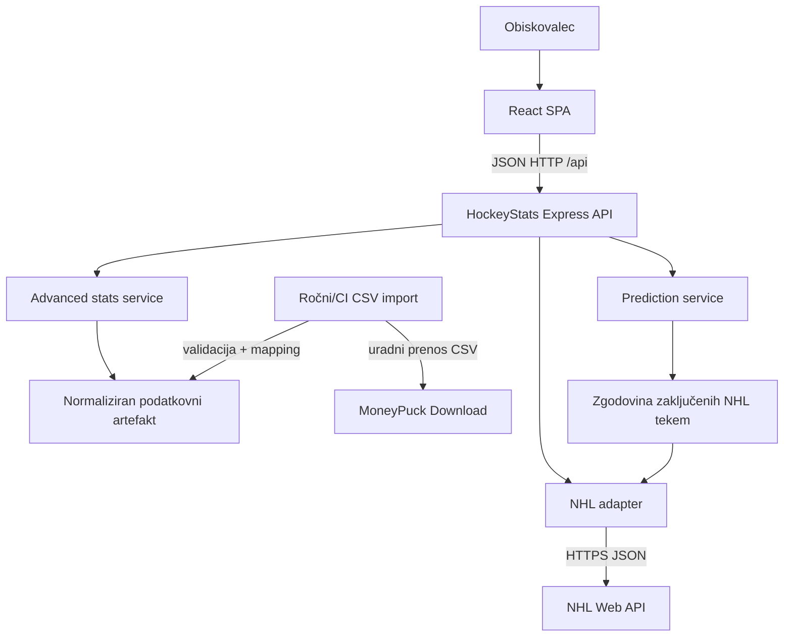

# 02 — Arhitektura, stack in modularnost

## Izbrani stack
| Plast | Izbira | Razlog |
|---|---|---|
| SPA | React + Vite + TypeScript | hiter razvoj statističnih strani; SSR ni potreben |
| CSS | Tailwind CSS | odzivnost, tematski design tokens |
| Routing | React Router | strani z globokimi povezavami |
| Server state | TanStack Query | caching, retry, pending/error |
| Vizualizacije | Recharts | prikaz grafov in primerjav |
| API | Node.js + Express + TypeScript | lahka integracijska logika |
| Validacija | Zod | tipi vhodov, parametrov in adaptiranih rezultatov |
| CSV | `csv-parse` | strog uvoz z datotečnega vira |
| Testi | Vitest, Supertest, React Testing Library | logika + HTTP + komponente |
| Repo | npm workspaces | preprosta skupna namestitev paketov |
| Deploy | Vercel (web), Railway (api) | ločena statična SPA in Node servis |

Verzije knjižnic določimo ob M1 z veljavnimi uradnimi stabilnimi izdajami in `package-lock.json`; ne vsiljuj starih številk iz primerov. Node LTS naj zadostuje trenutnim zahtevam Vite.

## Arhitekturna shema



## Zakaj uvoz podatkov in ne CSV fetch pri vsakem uporabniku?
MoneyPuck datoteke so lahko velike. V MVP CSV pridobi uvozna skripta (ročno ali kot del vnaprej pripravljenega deploya), preveri shemo in zgradi **majhen indeksiran, normaliziran artefakt**. Backend bere artefakt. Če ni dostopen, NHL osnovne funkcije še vedno delujejo. Nikoli ne prenašaj vsega CSV v brskalnik; ne zahtevaj velikega CSV ob vsaki zahtevi. Dogovor o objavi izpeljanih podatkov in atribuciji preveri pred javnim deployem.

## Odgovornosti slojev
- **Route:** URL, parametri, statusi, klic controllerja.
- **Controller:** koordinacija in pretvorba service rezultatov v javne response envelope.
- **Service:** primer uporabe (združevanje podatkov, projekcije, predsodbe cache).
- **Adapter:** dostop do zunanjega vira in runtime parsing.
- **Mapper:** zunanjo shemo preslika v notranji model; `null` za manjkajoče.
- **Prediction:** samo deterministične funkcije iz predhodne zgodovine.
- **Frontend:** izvaja klice na lastni REST API in riše UI; ne izvaja napovedne logike podvojeno.

## Priporočena struktura repozitorija

```text
hockeystats/
├── AGENTS.md
├── docs/
├── .agents/skills/
├── package.json                 # npm workspaces
├── package-lock.json
├── .env.example
├── frontend/
│   ├── src/{app,api,components,features,hooks,pages,types,utils}/
│   ├── package.json
│   └── vite.config.ts
├── backend/
│   ├── src/
│   │   ├── app.ts
│   │   ├── server.ts
│   │   ├── routes/
│   │   ├── controllers/
│   │   ├── services/{nhl,moneypuck,prediction}/
│   │   ├── adapters/
│   │   ├── cache/
│   │   ├── validation/
│   │   └── middleware/
│   ├── data/generated/         # manjši preprocesiran artefakt, pravila objave v 04
│   └── package.json
├── shared/
│   ├── src/{contracts,types}/
│   └── package.json
└── scripts/                     # CSV uvoz/validacija
```

## Model toka za dve integraciji
1. NHL vrne JSON za tekmo in sezono; adapter preveri minimalna polja, preslika čas, ekipo, rezultat.
2. MoneyPuck CSV uvoz obdeluje vrstice, izloči pravi `situation`, `gameId` in sezono, izdela mapo `(gameId,team,situation)`.
3. Enotni service odgovori za `/games/:gameId` in `/games/:gameId/advanced` v predvidljivi strukturi ter z `dataStatus`.
4. Napovedni service od zunanjih virov uporablja **samo NHL zgodovinske zaključene tekme**, filtrirane po času ciljne tekme.

## Nefunkcionalne zahteve
- Dostopnost: navigacija s tipkovnico, zadosten kontrast, dostopne etikete grafov.
- Performanse: brez velikih CSV v HTTP request path, lazy load strani in grafov.
- Zanesljivost: timeout, omejene ponovitve, cache z rokom in fallback ob manjkajočem MoneyPuck.
- Varnost: validacija parametrov, CORS samo dovoljen frontend, brez neomejenega `fetch` URL-jev iz uporabniškega vnosa.
- Prenosljivost: lokalni `npm` ukazi in hostatični frontend, deploy ne sme potrebovati produkcijskega skrivnega ključa za javne podatke.
