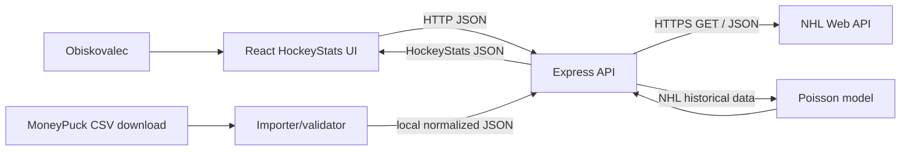

# 16 — Predaja za predmet TIDS / integracija storitev

## Naslov projekta
**HockeyStats — NHL Results, Advanced Analytics & Statistical Predictions**

## Kratek povzetek (primer za oddajo)
HockeyStats je spletna aplikacija, ki integrira dve različni zunanji storitvi oziroma vira: NHL Web API za JSON podatke o tekmah, razporedu in rezultatih ter MoneyPuck za CSV podatke o naprednih hokejskih metrikah. Backend obdeluje podatke, jih združi z identifikatorjem tekme in ekipe v skupen model in jih predstavi na interaktivnem spletnem vmesniku. Za prihodnje tekme zagotavlja dodatne, razložljive statistične napovedi na podlagi zgodovinskih NHL podatkov.

## Vloge in interakcije
| Vloga/sistem | Vloga pri integraciji | Podatki |
|---|---|---|
| Obiskovalec | zahteva pregled, primerjavo in napoved | datum, team, game ID, UI filtri |
| HockeyStats frontend | uporabniški vmesnik | HockeyStats JSON iz `/api/v1` |
| HockeyStats backend | orchestrator + transformacije + izračuni | normalizirani JSON podatki in modelni rezultati |
| NHL Web API | ponudnik 1 | JSON schedule/score/boxscore/team games |
| MoneyPuck | ponudnik 2 | CSV game-by-game advanced team stats |
| CSV importer | lokalni/CI adapter | validirane vrstice in artefakt |
| Razvijalec/Codex | priprava in vzdrževanje | koda, testni fixtures, dokumentacija |

## Integracijski diagram

## Dokumenti, formati in tipi
| Prenos | Format / protokol | Struktura / primer polj | Nadaljnja uporaba |
|---|---|---|---|
| NHL → API | HTTPS GET; JSON | game id (int), date/time (ISO), team ID/abbr, scores (int / null), SOG (int / null) | Game model, forme in zgodovina |
| MoneyPuck → importer | HTTPS download; CSV | sezona, game ID, ekipa, situation, xGF/xGA (float), shot attempts (int) | GameAdvanced model |
| Importer → API | lokalni JSON artefakt | indeks `(gameId, team, situation)` + metadata o viru | napredna statistika po tekmi |
| API → FE | HTTP JSON | Game, TeamSummary, GameAdvanced, Prediction | prikaz tabel in grafov |
| NHL historia → model | interni tipizirani objekti | zaključene igre pred kickoffom, goals/regulation, SOG | Poisson napoved |

**Opomba:** konkretna imena MoneyPuck stolpcev in NHL polj je treba s testom potrditi ob implementaciji. Tukaj so opisani **semantični** tipi integracij.

## Fakultetna kontrolna lista
- [ ] Izbrana domena in dokumentiran projekt.
- [ ] Opis vsaj dveh storitev + povezavi na vire.
- [ ] Opisan protokol, tip, dokumenti, vsebina in oblika podatkov.
- [ ] Diagram procesov, podatkovnih tokov in vlog.
- [ ] GitHub repo ustvarjen in povezava dodana pri oddaji.
- [ ] Asistenta **alenrajsp** in **patrikrek** dodana v repo po aktualnih navodilih predmeta (to uredi lastnik repozitorija; v dokumentu ni trditve, da sta že dodana).
- [ ] Izbira projekta zapisana v skupno preglednico predmeta.
- [ ] Prototip oziroma delujoč MVP in dokaz integracije.

## Kaj pokazati na predstavitvi
1. Izbran datum in realna NHL tekma, ki prihaja kot JSON.
2. Pridobljen MoneyPuck CSV in pojasnilo predprocesiranja.
3. Ista zgodovinska tekma z rezultatom in naprednimi metrikami.
4. Fallback: brez MoneyPuck ostane NHL del uporaben.
5. Upcoming game: model, verjetnosti, omejitve in test, da napoved ne uporablja prihodnjih podatkov.
